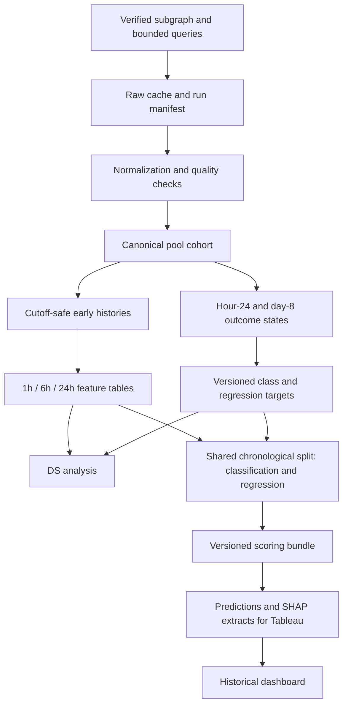

# System Architecture

## Design Principles

Use small Python modules for reusable logic and notebooks for academic explanation. Separate acquisition, normalization, feature generation, labeling, training, and presentation. All downstream work should replay locally from cached historical responses.

## Data Flow

Outcome labels can join features for training and evaluation by pool identifier. They must never enter inference features. The demo retrieves historical outcomes through a separate display path.

## Component Responsibilities

| Planned location | Responsibility |
|---|---|
| `src/defi_pulse/sources/` | Schema checks, GraphQL requests, discovery, history retrieval |
| `src/defi_pulse/data/` | Cache, normalization, sampling, quality, features, labels, storage |
| `src/defi_pulse/analysis/` | Reusable plots and statistical summaries |
| `src/defi_pulse/ml/` | Shared splits; classification/regression pipelines, task-specific metrics, calibration where applicable, SHAP, bundle loading |
| `src/defi_pulse/cli.py` | Bounded acquisition and reproducible offline workflows |
| `queries/`, `configs/` | Versioned query documents and nonsecret experiment settings |
| `notebooks/` | DS and ML narratives using reusable modules |
| `app/`, `tests/` | Historical interface and semantic tests |

Create components incrementally; this is not a requirement to generate empty modules.

## Proposed Stack Within the Context

Python 3.11 or later, HTTPX, pandas/NumPy, PyArrow/Parquet, scikit-learn, XGBoost, `shap`, Jupyter, Tableau export support, optional Streamlit, pytest, and Ruff. Choose and pin a compatible Python/dependency set during environment setup. DuckDB, statsmodels, and mypy remain optional. Use `pyproject.toml` with a reproducible lock strategy selected during setup.

## Approved Modeling Extension

The [2026-11-10 specification](modeling_update.md) changes the class threshold to 30%, adds percentage-change regression, and specifies SHAP and Tableau exports. Preserve ETL, GraphQL collectors, feature-window logic, chronological 70/15/15 allocation with an eight-day embargo, and Mann–Whitney U/chi-square methods. Reuse split IDs across both tasks and every window. Add `shap` when implementing modeling; the existing collectors remain standard-library only. Modeling, named statistical tests, Parquet model outputs, and dashboard integration remain planned.

## Artifact Boundaries

- `data/raw/`: exact responses, generally compressed and ignored by Git.
- `data/interim/`: normalized measurements and quality flags.
- `data/processed/`: selected cohorts, labels, features, and split assignments.
- `data/manifests/`: source identity, query/config hashes, dates, counts, errors, and artifact hashes.
- `models/`: task/window-specific preprocessing and estimators; optional classification calibrators, thresholds, regression target-transform metadata, feature order, versions, and evaluation metadata.
- Planned Tableau extracts: task-aware prediction tables and separate global/local SHAP tables in cleaned Parquet/CSV, with output units and source/model/target versions.

Historical data can be revised by an indexer. Preserve retrieval provenance and cached versions rather than assuming later downloads are identical.

## Operational Boundaries

Secrets come from local environment variables and are redacted from URLs, logs, cache metadata, and exceptions. Acquisition has request/pool caps, timeouts, bounded retries, and visible failures. No network request is needed to score a cached historical case. External schema failures or incomplete GraphQL responses must not masquerade as empty observations.
